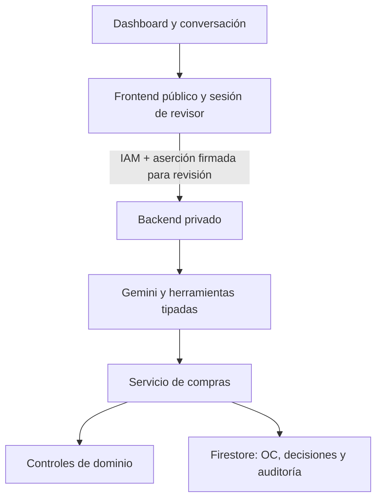

# Arquitectura vigente y tareas del PRD

**Entrada recomendada:** INSTRUCTIVO_CLOUD_RUN.md para despliegue manual. La app está implementada; los datos y reglas siguen siendo educativos hasta recibir el PRD.

## Flujo

## Decisiones de diseño

- Herramientas producen eventos de inicio/fin/duración/entrada/resultado reales por SSE; no mostramos razonamiento interno del modelo.
- El panel obtiene estado definitivo por GET /api/solicitudes/:id. Las tarjetas no infieren aprobación desde texto del LLM.
- El backend revalida en cada creación. Validaciones de grupo y agregado reutilizan los mismos controles.
- La revisión exige sesión de operador, firma de acción, justificación, snapshot y autoridad. Solo el backend interpreta las políticas.
- Rechazo persistente impide crear/reaprobar. Después de OC no se admiten cambios de decisión. Excepciones requieren políticas explícitas.
- Firestore coordina cambios de decisión y creación con transacciones; compara hash de decisión dentro de creación. Auditoría persiste acciones con actor y fecha.
- La auditoría de acciones se escribe después de la decisión/OC: si esa escritura falla, puede requerirse conciliación. No se presenta como outbox/auditoría transaccional completa.
- El SAP sigue simulado y se etiqueta así. No hay llamada BAPI ni OData.
- Los IDs de casos no codifican escenarios. Se lee evidencia. Presencia de factura no equivale por sí sola a fraude o retroactividad.
- El login es un operador de laboratorio compartido por despliegue, no SSO. Para producción se requiere proveedor de identidad por usuario, auditoría integral, cuotas distribuidas y política de reapertura.

## Matriz de contratos HTTP

| Ruta backend | Uso |
| --- | --- |
| GET /health | Modo/modelo/almacén/autenticación de revisión |
| GET /api/solicitudes | IDs reales disponibles |
| GET /api/solicitudes/:id | Resumen, controles, estado, acciones permitidas e historial |
| POST /api/chat | JSON o SSE con Accept:text/event-stream |
| POST /api/confirmar | ID, snapshot y justificación; actor firmado por BFF |
| POST /api/rechazar | Mismo contrato; decisión persistente |

Frontend añade /api/operator/login, /api/operator/session y /api/operator/logout. Cookie HttpOnly/Secure/SameSite; actor fijo de configuración, no enviado por el navegador. El BFF firma método/ruta/cuerpo y expiración; backend verifica. La firma no reemplaza IAM de servicio ni política de autorización.

## Archivos que debes adaptar al PRD

| Archivo | Responsabilidad | Qué completar |
| --- | --- | --- |
| backend/src/infrastructure/files/schemas.ts | Formatos externos Zod | Claves reales, opcionales, aprobación y maestros |
| backend/src/infrastructure/files/document-parser.ts | Extracción de cotización/factura | Formatos oficiales y ambigüedades |
| backend/src/infrastructure/files/fixture-repository.ts | Bundle y snapshot | Mapper real; correo y referencias de documentos |
| backend/src/domain/models.ts | Modelo interno | Subáreas, posiciones, moneda y estados exigidos |
| backend/src/domain/controls/reference.ts | Proveedor/centro/pago | Prioridad/defaults, subáreas y política de habilitación |
| backend/src/domain/controls/financial.ts | IVA/total | Redondeo, descuentos, tasas y tolerancias oficiales |
| backend/src/domain/controls/authorization.ts | Tope/aprobación | Base del límite y autoridad real |
| backend/src/domain/controls/documents.ts | Consistencia/retroactividad | Eventos comparados y evidencia de excepción |
| backend/src/domain/reviewer.ts | Alcance de revisores | Adaptar política a aprobadores del PRD |
| backend/src/domain/validate.ts | Agregar controles | Estados y prioridad exacta |
| backend/src/application/purchase-service.ts | Validar/crear/confirmar/rechazar | Flujos especiales, datos faltantes y reapertura si exige PRD |
| backend/src/tools/oc.ts | Catálogo Zod y despacho | Nombres/cantidad obligatorios si PRD los fija |
| backend/src/agent.ts | Ciclo y eventos SSE | Sesiones/historial si se exigen; preservar límites |
| backend/agent/prompt.md | Conversación | Reglas definitivas sin sustituir controles |
| backend/demo.ts | Seis casos sin LLM | Expectativas oficiales justificadas |
| backend/fixtures/** | Insumos educativos | Incorporar originales sin alterarlos para forzar éxito |

## Mapa de los demás módulos

### periferia_reto_backend

| Archivo | Trabajo y criterio |
| --- | --- |
| `periferia_reto_backend/.dockerignore` | Evita secretos y dependencias locales en contexto Docker. |
| `periferia_reto_backend/.env.example` | Configuración sin credenciales reales; ejemplos locales deben sustituirse en cloud. |
| `periferia_reto_backend/.gcloudignore` | Evita subir .env, node_modules, temporales y metadatos Git a Cloud Build. |
| `periferia_reto_backend/.github/workflows/deploy.yml` | CI por push/PR; CD opt-in con DEPLOY_ENABLED=true y WIF. |
| `periferia_reto_backend/.gitignore` | Evita claves, node_modules y outputs en Git. |
| `periferia_reto_backend/CLOUD_RUN_GITHUB.md` | Documentación/material de estudio; usar rutas de este mapa y actualizar al PRD. |
| `periferia_reto_backend/Dockerfile` | Imagen Node22; producción usa lockfile y puerto configurable. |
| `periferia_reto_backend/INSTRUCTIVO_CLOUD_RUN.md` | Documentación/material de estudio; usar rutas de este mapa y actualizar al PRD. |
| `periferia_reto_backend/README.md` | Arranque y enlaces al instructivo vigente. |
| `periferia_reto_backend/SOLUCION.md` | Defensa técnica: actualizar con reglas/casos reales y límites. |
| `periferia_reto_backend/VALIDACION.md` | Evidencia de comprobaciones ejecutadas y pendientes externas. |
| `periferia_reto_backend/agent/prompt.md` | Documentación/material de estudio; usar rutas de este mapa y actualizar al PRD. |
| `periferia_reto_backend/demo.ts` | Documentación/material de estudio; usar rutas de este mapa y actualizar al PRD. |
| `periferia_reto_backend/docs/GUIA_ESTUDIO.md` | Documentación/material de estudio; usar rutas de este mapa y actualizar al PRD. |
| `periferia_reto_backend/docs/Guia_estudio_Reto_3_SAP.pdf` | Documentación/material de estudio; usar rutas de este mapa y actualizar al PRD. |
| `periferia_reto_backend/infra/bootstrap.sh` | Alternativa con WIF para CI/CD; no necesaria para primer despliegue manual. |
| `periferia_reto_backend/infra/deploy-manual.sh` | Despliega backend y después frontend con Dockerfile desde fuente y comprueba salud. |
| `periferia_reto_backend/infra/setup-manual.sh` | APIs, runtime/builder, Firestore y secretos sin depender de GitHub Actions. |
| `periferia_reto_backend/package-lock.json` | Versiones de dependencias reproducibles. |
| `periferia_reto_backend/package.json` | Comandos reproducibles; no cambiar sin actualizar lockfile si hay dependencias. |
| `periferia_reto_backend/scripts/check-gemini.mjs` | Prueba mínima real con clave local; no imprime secretos. |
| `periferia_reto_backend/scripts/clean.mjs` | Limpia solo dist para no conservar código obsoleto. |
| `periferia_reto_backend/scripts/copy-assets.mjs` | Copia prompt y fixtures en la distribución backend. |
| `periferia_reto_backend/scripts/doctor.mjs` | Preflight de archivos y opcionalmente variables; no prueba conectividad cloud. |
| `periferia_reto_backend/scripts/smoke-http.mjs` | Proceso backend temporal y comprobación API. |
| `periferia_reto_backend/scripts/start-practice.mjs` | Activa modo educativo expresamente. |
| `periferia_reto_backend/src/agent/contracts.ts` | Tipos de mensajes, proveedor, herramientas, trazas y eventos. |
| `periferia_reto_backend/src/agent/practice.ts` | Comandos explícitos para practicar sin LLM. |
| `periferia_reto_backend/src/agent.ts` | Documentación/material de estudio; usar rutas de este mapa y actualizar al PRD. |
| `periferia_reto_backend/src/application/purchase-service.ts` | Documentación/material de estudio; usar rutas de este mapa y actualizar al PRD. |
| `periferia_reto_backend/src/bootstrap.ts` | Ensamblaje único: adaptadores, estado compartido en memoria o Firestore, agente y herramientas. |
| `periferia_reto_backend/src/config/env.ts` | Configura Gemini/puerto/Firestore/políticas y exige firma en Cloud Run. |
| `periferia_reto_backend/src/contracts/commands.ts` | Esquemas de entrada: ID, mensaje, snapshot y justificación. |
| `periferia_reto_backend/src/domain/controls/authorization.ts` | Documentación/material de estudio; usar rutas de este mapa y actualizar al PRD. |
| `periferia_reto_backend/src/domain/controls/common.ts` | Resultado uniforme CUMPLE/BLOQUEA/PENDIENTE. |
| `periferia_reto_backend/src/domain/controls/documents.ts` | Documentación/material de estudio; usar rutas de este mapa y actualizar al PRD. |
| `periferia_reto_backend/src/domain/controls/financial.ts` | Documentación/material de estudio; usar rutas de este mapa y actualizar al PRD. |
| `periferia_reto_backend/src/domain/controls/reference.ts` | Documentación/material de estudio; usar rutas de este mapa y actualizar al PRD. |
| `periferia_reto_backend/src/domain/fingerprint.ts` | Hash para cambios de datos; no es identidad humana. |
| `periferia_reto_backend/src/domain/models.ts` | Documentación/material de estudio; usar rutas de este mapa y actualizar al PRD. |
| `periferia_reto_backend/src/domain/ports.ts` | Interfaces asíncronas de repositorio, SAP, decisiones y auditoría. |
| `periferia_reto_backend/src/domain/reviewer.ts` | Documentación/material de estudio; usar rutas de este mapa y actualizar al PRD. |
| `periferia_reto_backend/src/domain/validate.ts` | Documentación/material de estudio; usar rutas de este mapa y actualizar al PRD. |
| `periferia_reto_backend/src/http/body.ts` | JSON con límite de tamaño. |
| `periferia_reto_backend/src/http/handler.ts` | Rutas JSON/SSE y errores estructurados con request ID. |
| `periferia_reto_backend/src/http/operator.ts` | Verifica firma, vencimiento, actor y vínculo método/ruta/cuerpo de la revisión. |
| `periferia_reto_backend/src/infrastructure/files/document-parser.ts` | Documentación/material de estudio; usar rutas de este mapa y actualizar al PRD. |
| `periferia_reto_backend/src/infrastructure/files/fixture-repository.ts` | Documentación/material de estudio; usar rutas de este mapa y actualizar al PRD. |
| `periferia_reto_backend/src/infrastructure/files/schemas.ts` | Documentación/material de estudio; usar rutas de este mapa y actualizar al PRD. |
| `periferia_reto_backend/src/infrastructure/firestore/state.ts` | Persistencia cloud, transacciones y consulta de auditoría. |
| `periferia_reto_backend/src/infrastructure/llm/gemini.ts` | Gemini generateContent nativo y preservación de parts/firmas entre rondas. |
| `periferia_reto_backend/src/infrastructure/memory/approval-store.ts` | Decisiones y auditoría locales; bloquea cambios tras OC. |
| `periferia_reto_backend/src/infrastructure/memory/sap.ts` | Simulador local con deduplicación y guardia de versión de decisión. |
| `periferia_reto_backend/src/infrastructure/memory/state.ts` | Estado local compartido de decisiones, OC y auditoría; aislado por runtime. |
| `periferia_reto_backend/src/server.ts` | Escucha HTTP en PORT sobre 0.0.0.0; sin reglas de compras. |
| `periferia_reto_backend/src/tools/oc.ts` | Documentación/material de estudio; usar rutas de este mapa y actualizar al PRD. |
| `periferia_reto_backend/tests/agent.test.ts` | Prueba automatizada del comportamiento del nombre del archivo; adaptar si cambia contrato. |
| `periferia_reto_backend/tests/architecture.test.ts` | Prueba automatizada del comportamiento del nombre del archivo; adaptar si cambia contrato. |
| `periferia_reto_backend/tests/controls.test.ts` | Prueba automatizada del comportamiento del nombre del archivo; adaptar si cambia contrato. |
| `periferia_reto_backend/tests/firestore.test.ts` | Prueba automatizada del comportamiento del nombre del archivo; adaptar si cambia contrato. |
| `periferia_reto_backend/tests/review.test.ts` | Prueba automatizada del comportamiento del nombre del archivo; adaptar si cambia contrato. |
| `periferia_reto_backend/tsconfig.json` | Chequeo estricto y salida NodeNext/ES2022. |

### periferia_reto_frontend

| Archivo | Trabajo y criterio |
| --- | --- |
| `periferia_reto_frontend/.dockerignore` | Evita secretos y dependencias locales en contexto Docker. |
| `periferia_reto_frontend/.env.example` | Configuración sin credenciales reales; ejemplos locales deben sustituirse en cloud. |
| `periferia_reto_frontend/.gcloudignore` | Evita subir .env, node_modules, temporales y metadatos Git a Cloud Build. |
| `periferia_reto_frontend/.github/workflows/deploy.yml` | CI por push/PR; CD opt-in con DEPLOY_ENABLED=true y WIF. |
| `periferia_reto_frontend/.gitignore` | Evita claves, node_modules y outputs en Git. |
| `periferia_reto_frontend/CLOUD_RUN_GITHUB.md` | Documentación/material de estudio; usar rutas de este mapa y actualizar al PRD. |
| `periferia_reto_frontend/Dockerfile` | Imagen Node22; producción usa lockfile y puerto configurable. |
| `periferia_reto_frontend/INSTRUCTIVO_CLOUD_RUN.md` | Documentación/material de estudio; usar rutas de este mapa y actualizar al PRD. |
| `periferia_reto_frontend/README.md` | Arranque y enlaces al instructivo vigente. |
| `periferia_reto_frontend/VALIDACION.md` | Evidencia de comprobaciones ejecutadas y pendientes externas. |
| `periferia_reto_frontend/package-lock.json` | Versiones de dependencias reproducibles. |
| `periferia_reto_frontend/package.json` | Comandos reproducibles; no cambiar sin actualizar lockfile si hay dependencias. |
| `periferia_reto_frontend/public/app.js` | UI segura con textContent, cliente SSE y estado definitivo del backend. |
| `periferia_reto_frontend/public/index.html` | Dashboard dividido, tarjetas, controles, decisión, herramientas e historial. |
| `periferia_reto_frontend/public/styles.css` | Layout adaptable a móvil/escritorio. |
| `periferia_reto_frontend/scripts/doctor.mjs` | Preflight de archivos y opcionalmente variables; no prueba conectividad cloud. |
| `periferia_reto_frontend/scripts/smoke-split.mjs` | Prueba dos procesos y revisión firmada, más eventos SSE. |
| `periferia_reto_frontend/src/operator.mjs` | Frontend: cookie de operador y aserciones HMAC de acciones. |
| `periferia_reto_frontend/src/server.mjs` | Frontend: estáticos, proxy IAM, streaming sin buffer, límites y login. |
| `periferia_reto_frontend/tests/dashboard.test.mjs` | Prueba automatizada del comportamiento del nombre del archivo; adaptar si cambia contrato. |
| `periferia_reto_frontend/tests/frontend.test.mjs` | Prueba automatizada del comportamiento del nombre del archivo; adaptar si cambia contrato. |
| `periferia_reto_frontend/tests/operator.test.mjs` | Prueba automatizada del comportamiento del nombre del archivo; adaptar si cambia contrato. |

## Qué falta que no debe fingirse completado

PRD/casos oficiales; acceso GitHub a los dos repos; proyecto/región/roles/facturación GCP; credencial y cuota Gemini; despliegue real y verificación de Firestore/IAM en tu proyecto. No se debe llamar producción a un login de operador de laboratorio. Los tests de nube usan dobles.

## Incorporaciones de despliegue manual

`periferia_reto_backend/infra/setup-manual.sh`: prepara API, identidades builder/runtime, Firestore y secretos. `periferia_reto_backend/infra/deploy-manual.sh`: despliega fuente/Dockerfiles en orden y verifica salud. `periferia_reto_backend/scripts/check-gemini.mjs`: verifica acceso real con clave local sin imprimirla. `scripts/doctor.mjs` de ambos repos: preflight estático/variables. `.gcloudignore` de ambos: excluye secretos y outputs de Cloud Build. `INSTRUCTIVO_CLOUD_RUN.md`: referencia actual del despliegue manual.
